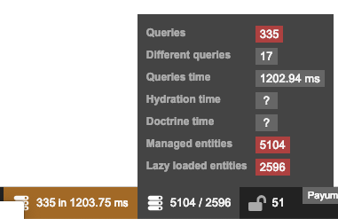

When developing forms with Symfony and Doctrine ORM, quite often we want to present the user a dropdown,
where he can choose an option from a list in database. The native [EntityType](https://symfony.com/doc/current/reference/forms/types/entity.html) was made exactly for this use case, and it works nicely out of the box.
Until your application and databases grow, and reach hundred if not thousands of entities. At this point, you start getting memory limit errors or time out on production - caused by the sheer volume of data, and sometimes the **infamous N+1 issue** will make the problem even worse.

<!-- more -->

## The base issue

The first issue will be quite obvious to all: when using `EntityType`, having a dropdown over 10 or 100 entities is fine ; over 10000, memory issues may arise _(besides user having a hard time to find the correct option, but I left this topic for a UX expert!)_.  That problem can be somehow sneaky - especially if you use data fixtures, with limited volumetry, during initial development, the issues will be discovered later, in production, "too late".

For the rest of the article, let's start coding a typical use case of `EntityType`:

```php
#[Entity]
class Article
{
    #[ManyToOne(targetEntity: Category::class)]
    private Category $category;
}
```
```php
#[Entity]
class Category
{
    #[Column]
    private string $name;

    #[OneToMany(targetEntity: Product::class)]
    private Collection $products;
}
```
```php
#[Entity]
class Product {}
```

```php
// The form type
class ArticleType extends AbstractType
{
    $builder->add('name', TextType::class);
    $builder->add('category', EntityType::class, [
        'class' => Category::class,
        // choice_value to be completed ; or use Category::__toString
    ]);
}
```

## The N+1 issue

On top of the base issue, when looping over entities which have associations, you can get the (infamous) N+1 issue. Either explicitly as you access related data, either implicity* _(see note below)_, a query is executed for each item in the collection, resulting in a large number of queries, and ultimately, even more performance issues.

```php
#[Entity]
class Category
{
    #[Column]
    private string $name;

    #[OneToMany(targetEntity: Product::class)]
    private Collection $products;

    public function __toString(): string
    {
        // In this example, we want to render "Name (XX products)",
        // Which will trigger a query to load the collection
        return $this->name.' '.count($this->products;
    }
}
```

```php
// The form type
class ArticleType extends AbstractType
{
    $builder->add('name', TextType::class);
    $builder->add('category', EntityType::class, [
        'class' => Category::class,
        // By default, Category::__toString will be called for every element
    ]);
}
```

When rendering the `ArticleType`, there will be one query to load all categories, and then one query for every category, to load the related product. As soon as you get hundred of categories, you will see the Symfony debug toolbar illuminating in orange and then red:



**The issue is easy to spot in the "Performance" tab of the Profiler.** You will see a typical "dashed" line, in Doctrine section. Every small notch is a DB query, which is being triggered every time we go over one item from the loop:


_* Note: In some cases, Doctrine will load related entities even if you don't access those. It can be the case if you configured those to be "eager" loaded, or if you are on the inverse side of a one-to-one association, due to a technical limitation._

## First workaround

When the N+1 issue arises, the usual first solution is to switch to eager loading - ie. forcing Doctrine to load all entities, Categories and Products, in one query with a `JOIN`.  
It can be done by using `addSelect` and `join` methods over the Doctrine QueryBuilder. In example, over the  previous form type:

```php
class ArticleType extends AbstractType
{
    $builder->add('name', TextType::class);
    $builder->add('category', EntityType::class, [
        'class' => Category::class,
        // To customize the Doctrine QueryBuilder behind, we are using this form option:
        // https://symfony.com/doc/current/reference/forms/types/entity.html#query-builder
        `query_builder` => function (EntityRepository $er) {
            return $er->createQueryBuilder('c')
                ->join('c.products', 'p')
                ->addSelect('p');
        },
    ]);
}
```

**This workaround is only temporary: we shifted the work from database, to PHP code.** As we are doing a joined query, Doctrine is now fetching N categories x P products, so N*P rows from database, that it must map to entities. The cost of the mapping process, called _hydration_, will increase exponentially. Soon we will be getting PHP timeout again.  
_If you want to learn more about this topic, I highly recommend [this article from Marco Pivetta (2015)](https://ocramius.github.io/blog/doctrine-orm-optimization-hydration/)._

## A better solution: LazyEntityType


## Final word

I started writing this article in 2019,
just after glancing over the topic during a talk, and here I'm in 2023 still getting it every now and then in production, over new projects.   
